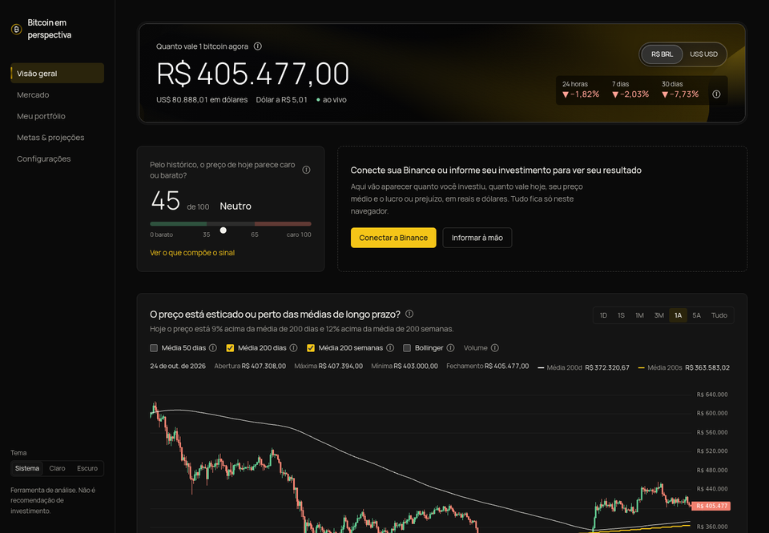
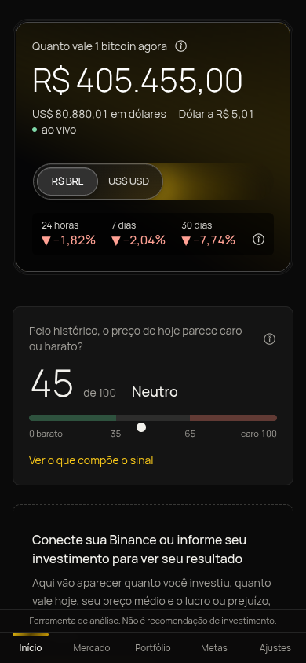
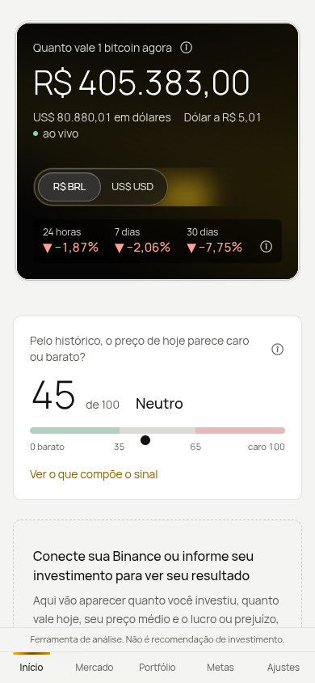
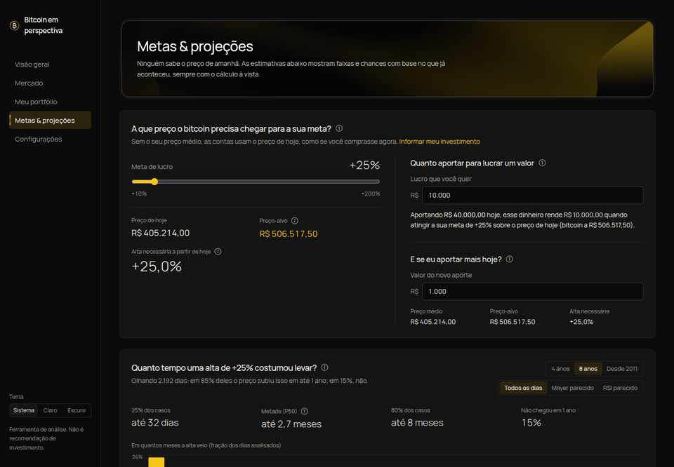
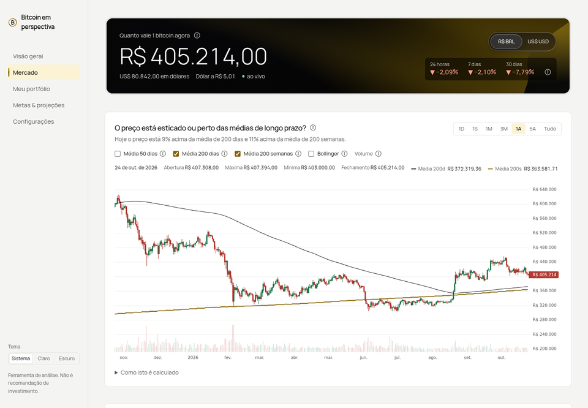

# Bitcoin em perspectiva

[](https://github.com/FelipeMassashi/Bitcoin_project/actions/workflows/ci.yml)
[](https://github.com/FelipeMassashi/Bitcoin_project/actions/workflows/deploy.yml)

**No ar em https://bitcoin-em-perspectiva.vercel.app**

Painel público para acompanhar bitcoin em reais e dólares. Mostra o preço ao vivo, os picos e as mínimas de cada mês, indicadores explicados em linguagem simples e simulações baseadas no histórico. Também mostra a sua posição, se você conectar a Binance ou informar o seu investimento à mão.

Ferramenta de análise. Não é recomendação de investimento. Nenhuma estimativa daqui é previsão: são faixas e chances calculadas com o que já aconteceu, sempre com o cálculo à vista.



<p>
  
  
</p>

## O que dá para fazer

| Tela | Para quê |
|---|---|
| **Visão geral** | Preço ao vivo em reais e dólares, o sinal de caro ou barato de hoje, a sua posição e o gráfico principal com médias móveis e Bandas de Bollinger. |
| **Mercado** | Os indicadores um a um, o histórico de cada um, os picos e as mínimas de cada mês, o mapa de calor de retornos mensais e o ciclo do halving. |
| **Meu portfólio** | Valor do seu bitcoin contra o que você investiu, o resultado de cada aporte e a comparação com comprar um valor fixo todo mês. |
| **Metas & projeções** | A que preço o bitcoin precisa chegar para a sua meta, quanto tempo uma alta assim costumou levar e as chances pelo Monte Carlo. |
| **Configurações** | Tema, moeda, a chave da Binance e o que este navegador guarda, com botões para apagar tudo. |

Cada número tem um ⓘ que explica o que é, para que serve e o que ele está dizendo agora.

<details>
<summary>Mais telas</summary>




</details>

## Feito com

Next.js 16 (App Router), React 19, TypeScript, Tailwind CSS 4, lightweight-charts e Recharts nos gráficos, TanStack Query, Zod, Vitest, [ShaderGradient](https://shadergradient.co/) e [Cult UI](https://www.cult-ui.com/).

## Rodar no seu computador

Precisa de Node 22.18 ou mais novo.

```bash
npm install
cp .env.example .env.local
node -e "console.log(require('crypto').randomBytes(32).toString('base64'))"
```

Cole a chave impressa no `ENCRYPTION_KEY=` do `.env.local` e rode:

```bash
npm run dev
```

O site abre em http://localhost:3000. Sem a `ENCRYPTION_KEY`, tudo funciona, menos a conexão com a Binance.

| Comando | O que faz |
|---|---|
| `npm run dev` | servidor de desenvolvimento |
| `npm test` | testes dos cálculos (Vitest) |
| `npm run lint` e `npm run typecheck` | ESLint e TypeScript |
| `npm run build` | build de produção |
| `npm run history` | regera `public/data/` (histórico 2011–2017 da Bitstamp e dólar PTAX do Banco Central) |

## Criar uma chave da Binance somente leitura

O site só lê **quanto bitcoin você tem** (Spot, Funding e Simple Earn). Não lê compras nem vendas, e não consegue mover nada.

1. Na Binance, abra **Perfil → Gerenciamento de API** e crie uma chave do tipo **gerada pelo sistema**.
2. Deixe marcada **apenas** "Habilitar leitura" (Enable Reading). Não marque trading, margem, futuros, saques nem transferências.
3. Deixe o acesso sem restrição de IP. O servidor do site não tem IP fixo. Como a chave só lê, quem a obtiver não consegue mover nada.
4. No site, abra **Seu investimento → Conectar a Binance** e cole a API Key e a Secret Key.

Se a chave tiver qualquer permissão além de leitura, o site recusa a conexão e explica o motivo. Ao desconectar de vez, apague também a chave em Gerenciamento de API, na Binance.

O custo do que você tem (total investido ou cada aporte) é sempre informado por você. A Binance só fornece a quantidade.

## Privacidade e segurança

- **Sem cadastro e sem banco de dados.** O servidor não guarda nada de nenhum Visitante.
- **Seus aportes e preferências** (moeda, meta, tema) ficam só no seu navegador, no IndexedDB e no localStorage. Em **Configurações** dá para ver o que está guardado e apagar a chave da Binance, o investimento ou tudo de uma vez.
- **As credenciais da Binance** vão uma vez para o servidor. Ele confere as permissões e devolve um cookie `httpOnly`, `Secure` e `SameSite=strict`, cifrado com AES-256-GCM pela `ENCRYPTION_KEY`, que vale por 30 dias. A Secret nunca volta para o navegador e nunca aparece em logs. **Desconectar** apaga o cookie.
- **As requisições assinadas** (HMAC-SHA256) saem só do servidor, com relógio sincronizado (`/api/v3/time`), limite de chamadas por IP e cache de 60 segundos.
- **Uma CSP rígida** só deixa o navegador falar com o próprio site, com as APIs públicas de mercado da Binance (`data-api.binance.vision` e `data-stream.binance.vision`) e com o índice de medo e ganância (`api.alternative.me`). Não há analytics nem scripts de terceiros. O gradiente animado é desenhado no seu aparelho, sem baixar nada de fora.

As decisões estão registradas em [docs/adr/](docs/adr/) e o vocabulário em [GLOSSARY.md](GLOSSARY.md).

## Como os cálculos funcionam

Todas as fórmulas ficam em `src/lib/` e têm testes com casos conhecidos.

### Seu investimento

- **Preço médio** é o total investido no bitcoin que você ainda tem, dividido pela quantidade. Uma venda tira custo na proporção da quantidade vendida. Ela não muda o preço médio e vira **lucro realizado**.
- **Aportes em reais e em dólares** são convertidos pela cotação do dia de cada aporte. Antes de outubro de 2020, quando ainda não existia o par USDT/BRL na Binance, a cotação usada é o dólar PTAX do Banco Central.
- **Sem quantidade informada**, o site estima a quantidade pelo preço de fechamento do dia do aporte ou pelo preço médio que você informou.

### Sinal composto (0 a 100)

Cada indicador vira uma nota de 0 a 100 pelo percentil do valor de hoje no próprio histórico. A nota final é a média ponderada dessas notas:

| Indicador | Peso |
|---|---|
| Mayer Multiple (preço ÷ média de 200 dias) | 25 |
| Distância da média de 200 semanas | 20 |
| Queda desde a máxima histórica | 15 |
| Medo e ganância | 15 |
| RSI diário | 10 |
| RSI semanal | 10 |
| MACD | 5 |

Abaixo de 35 é zona de compra, acima de 65 é zona de venda, e entre os dois é neutro. Os pesos ficam em `src/config/signal-weights.ts`. O backtest usa, em cada dia, só os dados disponíveis até aquele dia, sem olhar o futuro.

### Metas

- **Preço-alvo** = preço médio × (1 + meta). Sem preço médio, o site usa o preço de hoje.
- **Alta necessária** é quanto o preço precisa subir a partir de hoje para chegar ao preço-alvo.

### Tempo histórico até a meta

Para cada dia do período, o site conta quantos dias o fechamento levou para subir a Alta necessária, olhando até 2 anos para frente. Ficam de fora todos os dias dos últimos 2 anos, que ainda não tiveram o prazo inteiro. Eles saem tenham chegado ou não, porque deixar só os que chegaram tornaria a estimativa otimista. O resultado aparece em percentis (P25, P50, P80) e na fatia que não chegou em 1 ano. Dá para filtrar por dias parecidos com hoje, com Mayer ou RSI em faixa semelhante.

### Monte Carlo

A simulação gera 5.000 caminhos de 24 meses. Cada caminho sorteia blocos de 30 dias seguidos de retornos reais do período escolhido, o que preserva as fases de alta e de queda. O gráfico em leque mostra as faixas P10–P90 e P25–P75 e a mediana. Ao lado, aparece a chance de o preço tocar o alvo em 3, 6, 12 e 24 meses. A semente é fixa (os mesmos dados dão o mesmo resultado) e o cálculo roda num Web Worker, sem travar a página.

### Simulador de DCA

O simulador compra um valor fixo toda semana ou todo mês, pelo fechamento real de cada dia. Não considera taxas, spread nem impostos.

## Dados

- **Preços diários:** Bitstamp de 2011 a 2017 (arquivo estático) e Binance (BTCUSDT e BTCBRL) desde então.
- **Preço ao vivo:** WebSocket público da Binance, com reconexão automática.
- **Reais antes de outubro de 2020:** BTC/USD multiplicado pelo dólar PTAX do Banco Central.
- **Medo e ganância:** alternative.me, com histórico desde fevereiro de 2018.

## Publicar (grátis, na Vercel)

O site roda no plano Hobby da Vercel, que é gratuito para uso pessoal, na região de São Paulo (`gru1`). A publicação é feita pelo GitHub Actions:

- **`ci.yml`:** lint, typecheck, testes, build e uma checagem de que nenhum segredo foi parar no código do navegador, em cada push e pull request.
- **`deploy.yml`:** publica na Vercel quando o CI passa na `main`. Também dá para disparar à mão em Actions → Deploy → Run workflow.

A Vercel não publica sozinha a cada push (`git.deploymentEnabled: false` no `vercel.json`). Só versões que passaram no CI vão para o ar.

### Primeira vez

Rode o assistente na raiz do projeto, com o [GitHub CLI](https://cli.github.com/) logado (`gh auth login`):

```bash
./scripts/publicar.sh
```

Ele leva uns 5 minutos e faz o seguinte:

1. Abre a Vercel para você criar a conta (entre com o GitHub).
2. Pede o token da Vercel, que você cola sem ele aparecer na tela.
3. Cria e vincula o projeto `bitcoin-em-perspectiva`.
4. Gera a `ENCRYPTION_KEY` e a guarda direto na Vercel. Ninguém precisa vê-la.
5. Cadastra os secrets `VERCEL_TOKEN`, `VERCEL_ORG_ID` e `VERCEL_PROJECT_ID` no GitHub e dispara a primeira publicação.

Depois disso, todo push na `main` que passar no CI vai para o ar sozinho.

## Visual

- **Paleta preto e amarelo:** base preta ou grafite claro, com amarelo nos destaques e no botão principal. Todas as cores são tokens em `src/app/globals.css`, nos temas claro e escuro, e os gráficos leem os mesmos tokens.
- **Gradiente animado:** [ShaderGradient](https://shadergradient.co/), carregado sob demanda. Ele pausa fora da tela e vira um gradiente estático quando o aparelho pede menos movimento ou não tem WebGL.
- **Componentes:** [Cult UI](https://www.cult-ui.com/) em `src/components/cult/`: o número do preço que rola, o seletor de moeda e a moldura dos blocos com gradiente. Foram adaptados às cores e à acessibilidade do projeto.
